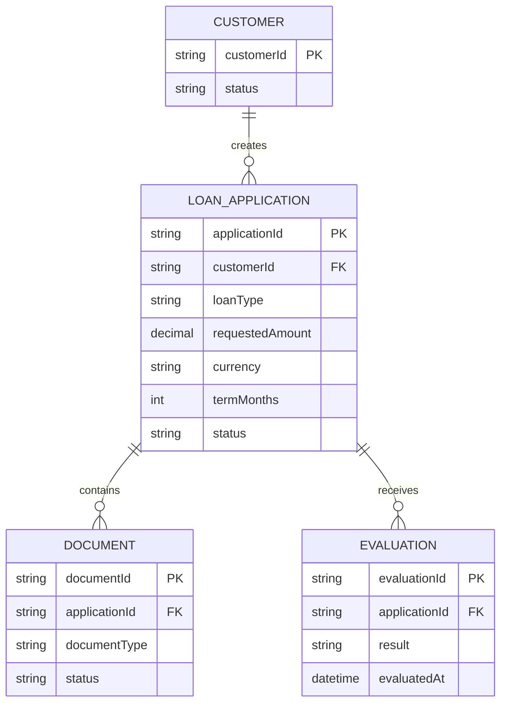

# Veritabanı ER Diyagramı

## 1. Amaç

Bu doküman, Kurumsal Kredi Yönetim Sistemi'nin temel veritabanı yapısını ve tablolar arasındaki ilişkileri tanımlar.

Veritabanı; kurumsal müşterileri, kredi başvurularını, başvuru belgelerini ve değerlendirme kayıtlarını saklayacak şekilde tasarlanmıştır.

## 2. Varlıklar ve Alanlar

| Tablo | Temel Alanlar | Açıklama |
|---|---|---|
| Customer | customerId (PK), status | Kurumsal müşteri kayıtlarını tutar. |
| LoanApplication | applicationId (PK), customerId (FK), loanType, requestedAmount, currency, termMonths, status | Müşterilerin kredi başvurularını tutar. |
| Document | documentId (PK), applicationId (FK), documentType, status | Başvurulara eklenen belge kayıtlarını tutar. |
| Evaluation | evaluationId (PK), applicationId (FK), result, evaluatedAt | Kredi başvurularına ait değerlendirme kayıtlarını tutar. |

**PK (Primary Key):** Her kaydı benzersiz şekilde tanımlar.

**FK (Foreign Key):** Tablolar arasındaki ilişkiyi kuran alandır.

## 3. ER Diyagramı

## 4. Tablolar Arasındaki İlişkiler

- **Customer – LoanApplication:** Bir müşteri birden fazla kredi başvurusu oluşturabilir. Her kredi başvurusu yalnızca bir müşteriye bağlıdır.
- **LoanApplication – Document:** Bir kredi başvurusuna birden fazla belge eklenebilir. Her belge tek bir başvuruya bağlıdır.
- **LoanApplication – Evaluation:** Bir kredi başvurusu için birden fazla değerlendirme kaydı oluşturulabilir. Böylece değerlendirme sürecinin geçmişi takip edilebilir.

## 5. Tasarım Kararları

- Her tablonun benzersiz bir birincil anahtarı bulunur.
- İlişkili kayıtlar yabancı anahtarlar üzerinden birbirine bağlanır.
- Başvuru durumu, belge durumu ve değerlendirme sonucu ayrı alanlarda tutulur.
- Değerlendirme geçmişi yeni kayıtlar oluşturularak saklanır; önceki değerlendirme kayıtları korunur.
- Gerçek kişi bilgileri ve hassas müşteri verileri bu portföy çalışmasında kullanılmaz.

*Not: Diyagram ve veritabanı yapısı kurgusal proje kapsamında tasarlanmıştır.*
