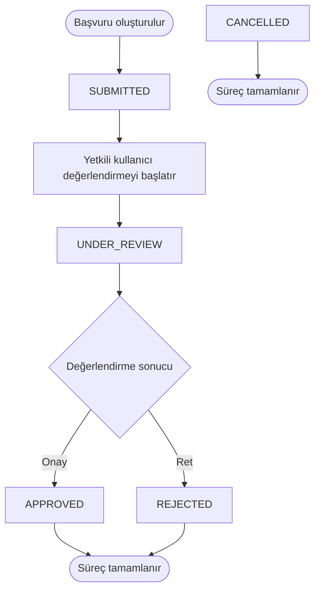

# Kredi Başvuru Durumları Diyagramı

## Amaç

Bu diyagram, kredi başvurusunun sistem içerisindeki durumlarını ve değerlendirme sürecindeki geçişlerini göstermektedir.

## Durum Akışı



## Açıklama

- **SUBMITTED:** Başvuru sisteme kaydedildiğinde atanır.
- **UNDER_REVIEW:** Yetkili kullanıcı değerlendirmeyi başlattığında atanır.
- **APPROVED:** Kredi başvurusu onaylandığında atanır.
- **REJECTED:** Kredi başvurusu reddedildiğinde atanır.
- **CANCELLED:** Başvuru iptal edildiğinde atanır.

**Not:** APPROVED ve REJECTED durumları tamamlanmış başvuruları ifade eder. Bu durumlardan tekrar değerlendirme aşamasına geçiş yapılamaz. CANCELLED durumu da iptal edilmiş başvurular için kullanılan son durumdur.
```
