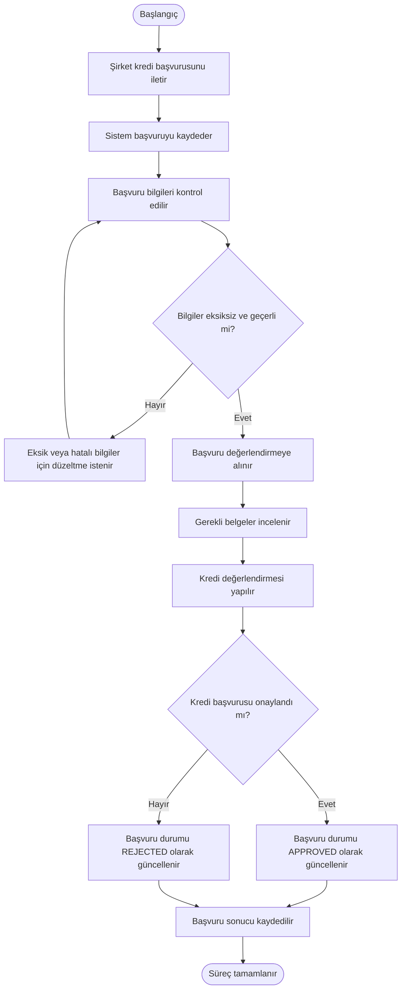

# Kredi Başvuru Süreci Akış Diyagramı

## Amaç

Bu diyagram, kurumsal kredi başvurusunun bankaya iletilmesinden değerlendirme sonucunun oluşturulmasına kadar geçen iş sürecini göstermektedir.

## Süreç Akışı

## Açıklama

Başvuru süreci, şirketin kredi talebini bankaya iletmesiyle başlar. Sistem başvuruyu kaydettikten sonra bilgilerin eksiksiz ve geçerli olup olmadığı kontrol edilir.

Bilgiler uygun değilse düzeltme istenir. Kontrolü geçen başvurular değerlendirme aşamasına alınır. Gerekli belgeler incelenerek kredi değerlendirmesi yapılır.

Değerlendirme sonucunda başvuru onaylanır veya reddedilir. Son karar sistemde kaydedilerek süreç tamamlanır.

**Not:** Bu diyagram, proje kapsamında tasarlanan hedef süreci (To-Be) temsil etmektedir.
