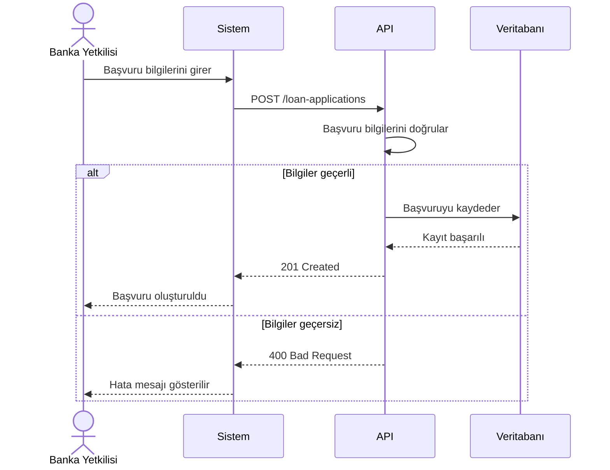

# Kredi Başvurusu Sıralama Diyagramı

## Amaç

Bu diyagram, kredi başvurusu oluşturulurken kullanıcı, sistem, API ve veritabanı arasındaki etkileşimi göstermektedir.

## İşlem Akışı



## Açıklama

Banka yetkilisi başvuru bilgilerini sisteme girer. Sistem, bilgileri API aracılığıyla gönderir.

API, gelen bilgileri kontrol eder. Bilgiler geçerliyse başvuru veritabanına kaydedilir ve başarılı yanıt döndürülür.

Bilgiler geçersizse kayıt oluşturulmaz ve kullanıcıya hata yanıtı iletilir.
```
