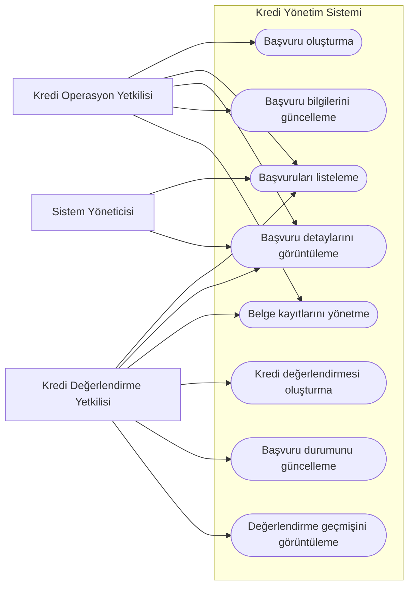

# Kredi Yönetim Sistemi Kullanım Senaryoları

## Amaç

Bu diyagram, kredi yönetim sistemindeki kullanıcı rollerini ve bu rollerin gerçekleştirebildiği temel işlemleri göstermektedir.

## Kullanım Senaryosu Diyagramı



## Açıklama

Sistem üç temel kullanıcı rolü üzerinden ele alınmıştır:

- **Kredi Operasyon Yetkilisi:** Başvuruları oluşturur, listeler, başvuru bilgilerini ve belge kayıtlarını yönetir.
- **Kredi Değerlendirme Yetkilisi:** Başvuruları inceler, değerlendirme kayıtlarını oluşturur ve başvuru durumunu günceller.
- **Sistem Yöneticisi:** Sistem kapsamında başvuruları görüntüleyebilir ve yönetim süreçlerini takip edebilir.

**Not:** Kullanıcıların işlem yetkileri proje kapsamında belirlenen rol ve yetkilendirme kurallarına göre sınırlandırılır.
```
