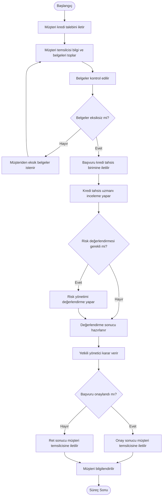

# Mevcut Süreç Analizi (AS-IS)

## 1. Amaç

Bu doküman, kurgusal bir bankada kurumsal kredi başvurusunun mevcut işleyişini tanımlamak ve süreçte karşılaşılabilecek operasyonel sorunları ortaya koymak amacıyla hazırlanmıştır.

Mevcut süreç, proje kapsamında oluşturulan varsayımsal bir bankacılık senaryosuna dayanmaktadır.

## 2. Sürecin Tanımı

Kurumsal müşteri, finansman ihtiyacını karşılamak amacıyla bankaya kredi başvurusunda bulunur. Başvuru sürecinde müşteri temsilcisi, gerekli bilgileri ve finansal belgeleri müşteriden temin ederek ilgili birimlere iletir.

Kredi başvurusu; belge kontrolü, kredi değerlendirmesi, risk incelemesi ve yetkili yönetici kararı aşamalarından geçer.

## 3. Süreçte Yer Alan Paydaşlar

| Paydaş | Süreçteki Görevi |
|---|---|
| Kurumsal Müşteri | Kredi talebini iletir ve gerekli belgeleri sağlar. |
| Kurumsal Müşteri Temsilcisi | Başvuruyu alır, müşteri bilgilerini ve belgelerini ilgili birimlere iletir. |
| Operasyon Uzmanı | Başvuru belgelerinin eksiksizliğini kontrol eder. |
| Kredi Tahsis Uzmanı | Kredi başvurusunu ve finansal bilgileri değerlendirir. |
| Risk Yönetimi Uzmanı | Gerekli durumlarda kredi riskini inceler. |
| Kredi Tahsis Müdürü | Kredi başvurusu hakkında karar verir. |

## 4. Mevcut Süreç Adımları

1. Kurumsal müşteri, kredi talebini bankaya iletir.
2. Müşteri temsilcisi, müşteriden gerekli bilgileri ve finansal belgeleri talep eder.
3. Müşteriden gelen bilgi ve belgeler kontrol edilir.
4. Eksik belge bulunması durumunda müşteriden ek belge istenir.
5. Belgeler tamamlandığında başvuru kredi tahsis birimine iletilir.
6. Kredi tahsis uzmanı, başvuruyu ve finansal belgeleri inceler.
7. Gerekli görülmesi durumunda risk yönetimi biriminden değerlendirme talep edilir.
8. İlgili değerlendirmeler tamamlanarak karar için yetkili yöneticiye iletilir.
9. Yetkili yönetici kredi başvurusunu onaylar veya reddeder.
10. Karar müşteri temsilcisine iletilir.
11. Müşteri temsilcisi sonucu müşteriye bildirir.

## 5. Süreç Akış Diyagramı

## 6. Mevcut Süreçte Tespit Edilen Olası Sorunlar

| Sorun ID | Olası Sorun | Sürece Etkisi |
|---|---|---|
| AS-01 | Belgelerin farklı ortamlarda tutulması | Belgelere erişim ve takip zorlaşabilir. |
| AS-02 | Eksik belgelerin manuel takip edilmesi | Başvuru sürecinde gecikmeler yaşanabilir. |
| AS-03 | Başvuru durumunun merkezi olarak izlenememesi | Sürecin hangi aşamada olduğu belirsizleşebilir. |
| AS-04 | Departmanlar arasında manuel bilgi aktarımı | Bilgi kaybı veya iletişim gecikmeleri yaşanabilir. |
| AS-05 | Tekrarlanan veri girişleri | Operasyonel iş yükü ve hatalı veri girişi riski artabilir. |

## 7. Süreç Varsayımları

- Başvurular müşteri temsilcisi aracılığıyla alınmaktadır.
- Belgeler farklı dijital ortamlarda veya manuel yöntemlerle takip edilebilmektedir.
- Kredi değerlendirmesi ilgili uzmanlık birimleri tarafından gerçekleştirilmektedir.
- Kredi onay ve ret kararları yetkili yöneticiler tarafından verilmektedir.
- Başvuru sonucu müşteriye müşteri temsilcisi aracılığıyla iletilmektedir.

Bu süreç, gerçek bir bankanın doğrulanmış işleyişini değil, proje kapsamında modellenen mevcut durum senaryosunu temsil etmektedir.
