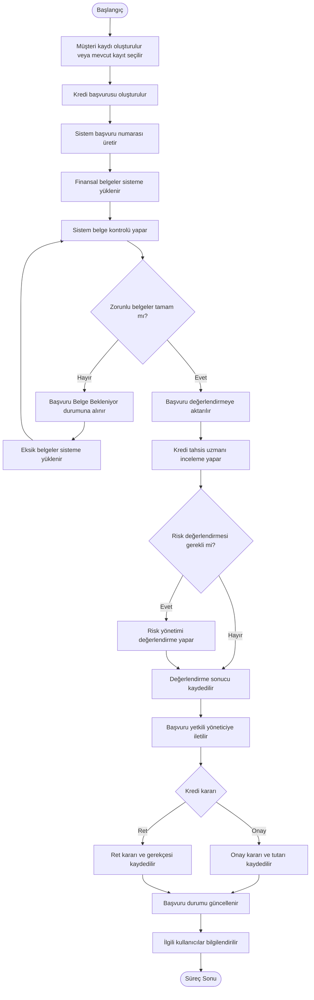

# Hedef Süreç Analizi (TO-BE)

## 1. Amaç

Bu dokümanın amacı, Kurumsal Kredi Yönetim Sistemi'nin devreye alınmasıyla birlikte kurumsal kredi başvuru süreçlerinin nasıl yürütüleceğini tanımlamaktır.

Hedef süreçte kredi başvurularının, finansal belgelerin, değerlendirme aşamalarının ve kararların merkezi bir sistem üzerinden yönetilmesi amaçlanmaktadır.

## 2. Hedef Sürecin Tanımı

Kurumsal müşteri için kredi başvurusu sistem üzerinden oluşturulur. Başvuruya ait müşteri bilgileri, kredi talep detayları ve finansal belgeler sisteme kaydedilir.

Sistem, zorunlu belgelerin tamamlanma durumunu kontrol eder. Eksik belge bulunması durumunda başvuru belge bekleme durumuna alınır.

Belgeler tamamlandığında başvuru kredi değerlendirme sürecine aktarılır. İlgili uzmanlar değerlendirmelerini sistem üzerinden gerçekleştirir. Gerekli durumlarda risk yönetimi birimi sürece dahil edilir.

Değerlendirme tamamlandıktan sonra başvuru, yetkili yöneticinin onay veya ret kararına sunulur. Verilen karar ve başvuru geçmişi sistemde kayıt altına alınır.

## 3. Hedef Süreç Adımları

1. Kurumsal müşteri temsilcisi sistem üzerinden müşteri kaydını oluşturur veya mevcut müşteri kaydını seçer.
2. Müşterinin kredi talebi sisteme girilir.
3. Sistem başvuru için benzersiz bir başvuru numarası oluşturur.
4. Gerekli finansal belgeler sisteme yüklenir.
5. Sistem zorunlu belgelerin tamamlanma durumunu kontrol eder.
6. Eksik belge bulunması durumunda başvuru "Belge Bekleniyor" durumuna alınır.
7. Belgeler tamamlandığında başvuru kredi değerlendirme aşamasına aktarılır.
8. Kredi tahsis uzmanı başvuruyu ve finansal bilgileri inceler.
9. Gerekli görülmesi durumunda risk yönetimi uzmanı değerlendirme yapar.
10. Değerlendirme sonuçları sistem üzerinden kayıt altına alınır.
11. Başvuru yetkili kredi tahsis müdürünün onayına sunulur.
12. Yetkili yönetici başvuruyu onaylar veya reddeder.
13. Karar, gerekçesi ve işlem tarihiyle birlikte sisteme kaydedilir.
14. Başvuru durumu güncellenir ve ilgili kullanıcılar bilgilendirilir.

## 4. Hedef Süreç Akış Diyagramı

## 5. Hedef Süreçte Sağlanması Beklenen İyileştirmeler

| Mevcut Sorun | Hedef Süreçteki İyileştirme |
|---|---|
| Belgelerin farklı ortamlarda tutulması | Belgelerin merkezi sistem üzerinden yönetilmesi |
| Eksik belgelerin manuel takip edilmesi | Belge durumlarının sistem üzerinden izlenmesi |
| Başvuru durumunun merkezi olarak izlenememesi | Her başvuru için güncel durum bilgisinin tutulması |
| Departmanlar arasında manuel bilgi aktarımı | Görev ve değerlendirme adımlarının sistem üzerinden yürütülmesi |
| Tekrarlanan veri girişleri | Müşteri bilgilerinin mevcut kayıtlardan kullanılabilmesi |

## 6. Hedef Süreç Kuralları

- Her başvuru benzersiz bir başvuru numarası ile takip edilmelidir.
- Zorunlu belgeler tamamlanmadan başvuru değerlendirme aşamasına geçmemelidir.
- Değerlendirme ve onay işlemleri yetkili kullanıcılar tarafından gerçekleştirilmelidir.
- Kredi kararları ve karar gerekçeleri sistemde kayıt altına alınmalıdır.
- Başvuru durumundaki değişiklikler ilgili kullanıcılar tarafından görüntülenebilmelidir.
- Kullanıcıların işlem geçmişi denetlenebilir olmalıdır.

## 7. Beklenen Kazanımlar

- Kredi başvuru süreçlerinin merkezi olarak yönetilmesi.
- Belge eksikliklerinin daha kolay takip edilmesi.
- Başvuru aşamalarının görünürlüğünün artırılması.
- Departmanlar arasındaki işlem takibinin kolaylaştırılması.
- Tekrarlanan manuel işlemlerin azaltılması.
- Kredi kararlarının ve işlem geçmişinin kayıt altına alınması.

## 8. Varsayımlar

- Hedef süreç, proje kapsamında tasarlanan kurgusal sistemin işleyişini temsil etmektedir.
- Kullanıcıların erişim ve işlem yetkileri sistem üzerinden yönetilecektir.
- Finansal değerlendirme ve kredi kararları ilgili banka çalışanları tarafından verilecektir.
- Gerçek bankacılık sistemleriyle entegrasyonlar proje kapsamında simüle edilecektir.
